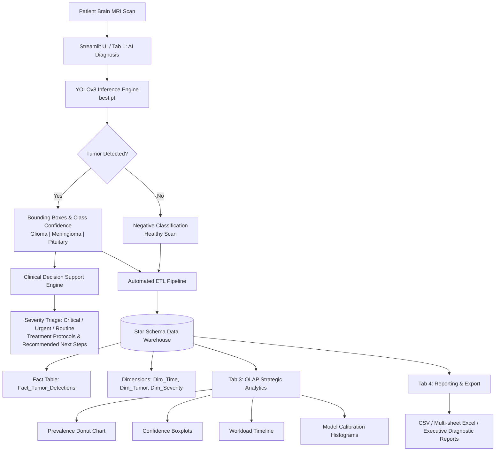

# 🧠 NeuroScan AI — Brain Tumor Detection & Clinical Intelligence Platform

An end-to-end, medical-grade diagnostic intelligence platform combining **YOLOv8 deep learning object detection**, **Clinical Decision Support (CDSS)**, and a **Star Schema Data Warehouse** with an interactive **OLAP Analytics Dashboard**.

---

## 📌 Table of Contents
- [Overview](#-overview)
- [System Architecture](#-system-architecture)
- [Key Features](#-key-features)
- [Model Performance & Training](#-model-performance--training)
- [Sample Testing](#-sample-testing)
- [Medical Disclaimer](#-medical-disclaimer)

---

## 🔬 Overview

Accurate and prompt identification of brain tumors on Magnetic Resonance Imaging (MRI) is vital for neuro-oncology treatment planning. **NeuroScan AI** bridges the gap between raw computer vision outputs and hospital analytics workflows:

1. **Real-time Diagnostic Detection (OLTP)**: Ingests patient brain MRI scans and detects tumor regions with high precision.
2. **Automated ETL & Star Schema Warehouse**: Dynamically logs every scan inference into an analytical dimensional warehouse structure (`Fact_Tumor_Detections` + `Dim_Time`, `Dim_Tumor`, `Dim_Severity`).
3. **Clinical Decision Support (CDSS)**: Provides protocol recommendations, urgency stratification (Critical / Urgent / Routine), and historical outcome benchmarks (cross-referenced against clinical patient cohorts).
4. **OLAP Healthcare Intelligence**: Equips radiologists and healthcare administrators with disease prevalence trends, workload timelines, and model calibration metrics.

visit dashboard : [https://brain-tumor-dashboard-kamaputra-lonuiqbsvulyenps3vdkrs.streamlit.app/]
---

## 🏗️ System Architecture

---

## ✨ Key Features

### 1. 🔍 AI Diagnosis (OLTP)
- Real-time inference on MRI images (`JPG`, `PNG`, `JPEG`).
- Adjustable confidence threshold slider (0.00 – 1.00) for tuning sensitivity vs. precision.
- Instant bounding box localization and multi-class classification:
  - **Glioma** (Malignant)
  - **Meningioma** (Benign)
  - **Pituitary** (Tumor)
  - **No Tumor** (Normal / Healthy)
- Patient record linking via optional `Patient ID` field.

### 2. 🗄️ Data Warehouse (Star Schema)
- Automatic **ETL (Extract, Transform, Load)** writes inference measurements into `tumor_warehouse.csv`.
- **Fact Table**: `Fact_Tumor_Detections` (`Detection_ID`, `Scan_Date`, `Confidence`, `Box_Coordinates`, `Severity_Level`, `Patient_ID`).
- **Dimension Tables**:
  - `Dim_Time`: Hierarchical temporal analysis (Year, Month, Day, Day of Week).
  - `Dim_Tumor`: Classification category (Malignant, Benign, Healthy).
  - `Dim_Severity`: Clinical priority mapping (Critical, Urgent, Routine, None).
- Live warehouse statistics and reset controls.

### 3. 📈 Strategic Analytics Dashboard (OLAP)
- **Executive KPIs**: Total Scans, Positive Detections, Detection Rate %, Average Confidence %, Healthy Scans.
- **Disease Prevalence Analysis**: Interactive Plotly donut chart of tumor class distributions.
- **Confidence Distribution**: Boxplots stratified by tumor diagnosis.
- **Workload Timeline**: Daily scan volume trends over time.
- **Daily Tumor Composition**: Stacked bar chart showing daily diagnostic breakdowns.
- **Model Calibration**: Distribution histogram of model confidence scores.

### 4. 📋 Export & Clinical Reporting
- Full dataset export in **CSV** or styled **Multi-sheet Excel (`.xlsx`)** with automated executive summaries.
- Date-range filtering for targeted clinical audits.
- One-click comprehensive Diagnostic Summary Report generator.

---

## 📊 Model Performance & Training

The detection model was fine-tuned on custom annotated brain MRI datasets using **YOLOv8 Nano** with medical-specific augmentations (disabled color jittering to retain grayscale MRI tissue contrast, rotational augmentations, low initial learning rate):

| Metric | Score | Clinical Relevance |
| :--- | :--- | :--- |
| **mAP@50** | **92.5%** | High overlap accuracy at IoU 0.50 |
| **Precision (B)** | **90.1%** | Minimizes false positive diagnoses |
| **Recall (B)** | **87.4%** | Critical tumor boundary capture rate |
| **mAP@50-95** | **68.4%** | High localization fidelity across IoU thresholds |

- **Training Epochs**: 100 epochs
- **Base Architecture**: `yolov8n.pt`
- **Trained Weights**: `best.pt` (stored in root)
- **Colab Training Pipeline**: Documented in `COLAB_SETUP_GUIDE.md` & `BrainTumor_Colab_Notebook.ipynb`

---

## 🧪 Sample Testing

Sample MRI scans are included in the [`samples/`](samples/) directory:
- `sample_glioma.jpg` — Test high-grade malignant glioma detection
- `sample_meningioma.jpg` — Test benign meningioma detection
- `sample_pituitary.jpg` — Test pituitary tumor detection
- `sample_notumor.jpg` — Test negative/healthy MRI scan verification

Upload any of these in the **AI Diagnosis** tab to verify system functionality immediately.

---

## ⚕️ Medical Disclaimer

> [!WARNING]
> **For Research, Educational, and Portfolio Purposes Only.**
> This software and its underlying AI models are not certified medical devices (CE-IVD or FDA approved). Predictions, severity classifications, and clinical protocol suggestions generated by this system must **never** be used as a standalone substitute for direct clinical examination, diagnostic biopsy, or consultation with a board-certified radiologist or neuro-oncologist.

